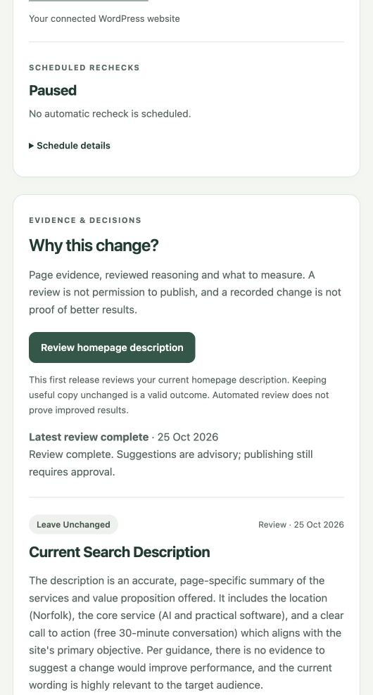

# Automatic recommendation slice

The dashboard starts a scoped Core review with “Review homepage description”. Core's existing durable queue captures the current homepage and aggregate traffic, generates one current-description decision, and makes a separate critical review call. The dashboard displays progress, failures, accepted advice, needs-revision decisions and rejected advice in the existing evidence cards.

Evidence is dated, not perpetually current. Source references are restricted to the reviewed Google snippet guidance. Exact quotes and original wording are checked against the captured page. Generation may recommend retaining existing copy. Page changes during review withhold all new results. Core retains the snapshot, metrics, reviewer outcome and served-model provenance.

The runtime workflow is an adaptation of the pinned evidence, SEO, copy-editing, CRO and analytics contract. It is not unrestricted web research. The working business brief is labelled as published-site evidence, not independently verified buyer research. Automatic CTA/form advice is deferred; historical manually reviewed records remain visible. No conversion baseline is supplied to the model in this slice.

Publishing approval remains required; this feature cannot publish, approve, submit a form or change indexing. Accepted suggestions do not yet create editable publishing drafts. Customer rollout, other pages and scheduled regeneration are deferred.

Validation: production-results build and 11 focused recommendation/proxy checks passed. Core PR #2315 carries worker validation, architecture checks and the normal release gates. Production proof is recorded below after release.

## Release priority confirmed by David

Finish the smallest usable own-site loop first: evidence, recommendations, human approval, description publishing, verification/undo, and existing search/referral/enquiry monitoring. Use it to improve Unimpossible before extending the platform. Defer additional plugins, customer onboarding, multi-page generation, scheduled recommendation runs and richer reports. A failed basic step is a bug to fix, not a reason to add another module.

The first production run failed closed on malformed model output. The narrow correction binds the original description in a strict output schema and limits the first automatic release to the description workflow (Core PR #2317). No site content was changed by the failed run.

## Production proof — 25 October 2026

Core correction PR #2317 merged and release `4c077b704e820eb1a8f9939dc66898c60e62a333` passed beta and production verification, including queue workers. The final dashboard-triggered run `2ffd508f-f2cc-41a1-bbf4-ba8b124551f9` completed at 09:59:00 UTC. It stored one recommendation (`e9fad8c4-18f9-489f-b4e9-efdaaf332053`): retain the existing homepage description. The separate automated review accepted that decision. The dashboard visibly shows completion, the dated decision, source and review.

Comparison with the immediately preceding results confirmed publishing approval remains required and all four description operations are unchanged. A fresh public homepage fetch returned HTTP 200 with the same description, robots metadata, absence of an X-Robots-Tag header and three forms. No publication or indexing change was made. The existing site audit schedule remains paused; this release does not enable scheduled recommendation generation. Existing daily traffic imports remain separate.

This demonstrates the automatic generation/review/display path, not traffic uplift. The model's “none identified” downside is its assessment; the earlier human-reviewed record retains the narrower CTA/Chambers caveats. Recommendations remain advisory. Accepted changes still use the existing manual description draft and approval flow; no automatic publishing handoff was added.

Final correction validation: ten focused backend/architecture checks passed, alongside normal PR, merge-queue and release checks. Dashboard validation remains the production-results build and eleven focused checks already recorded above; no additional test framework was introduced.

